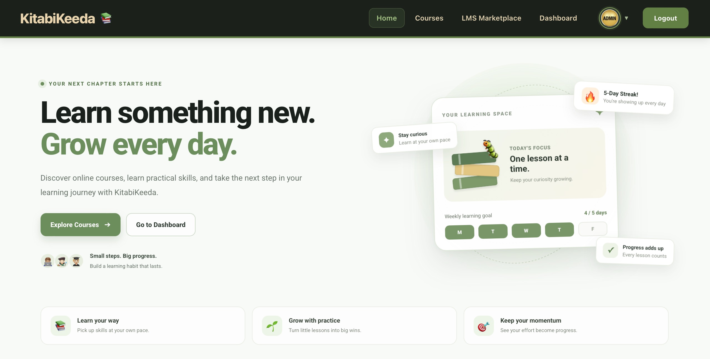
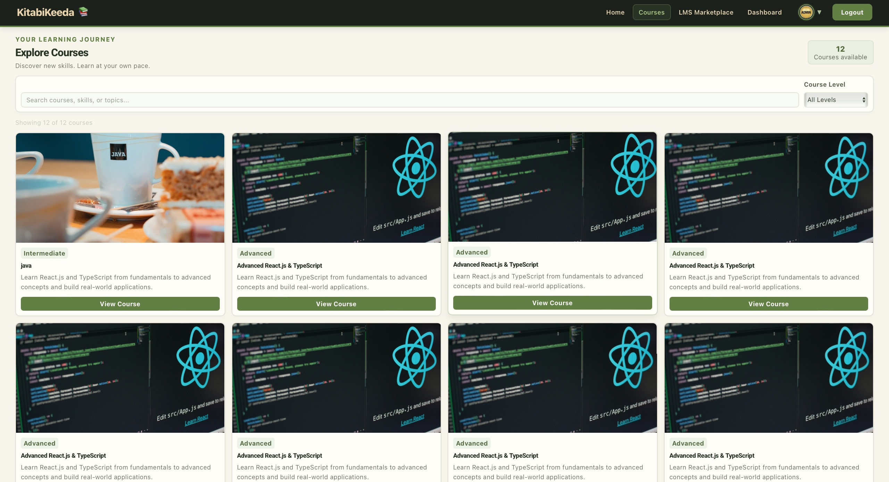
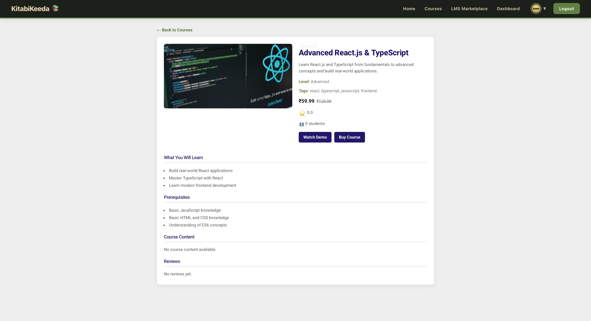
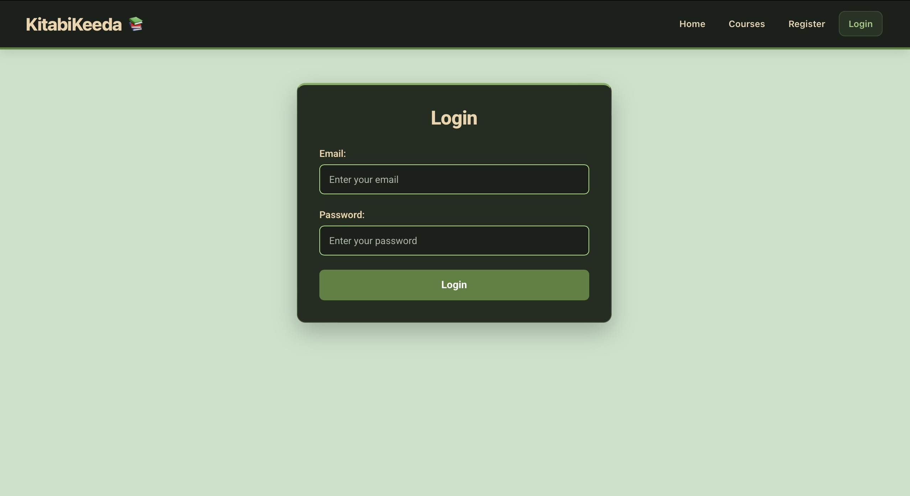
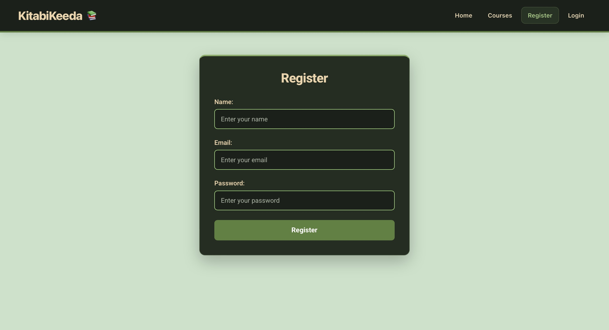
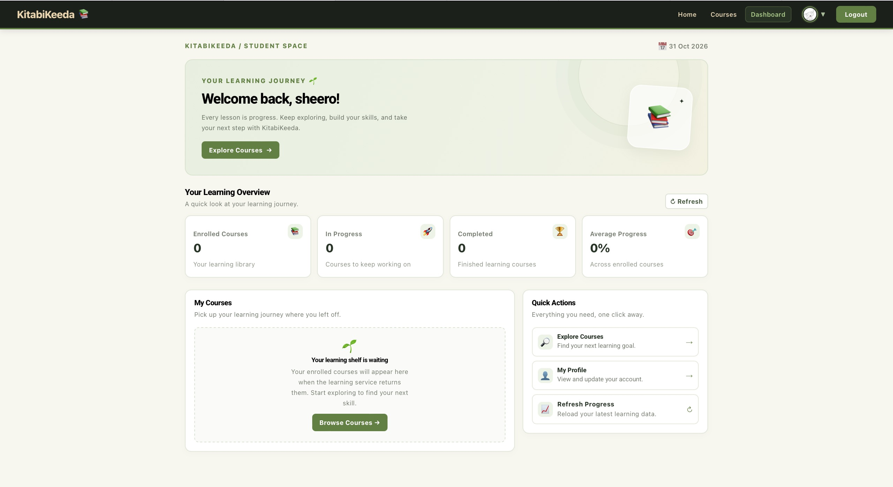
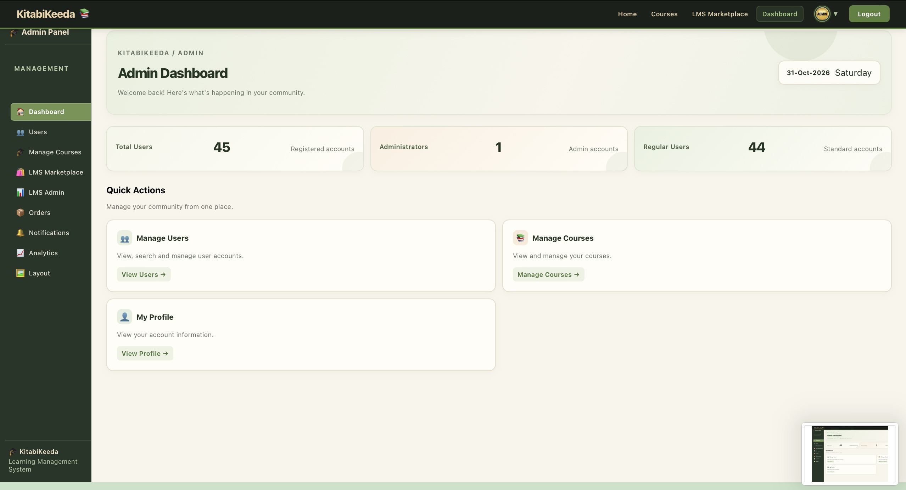
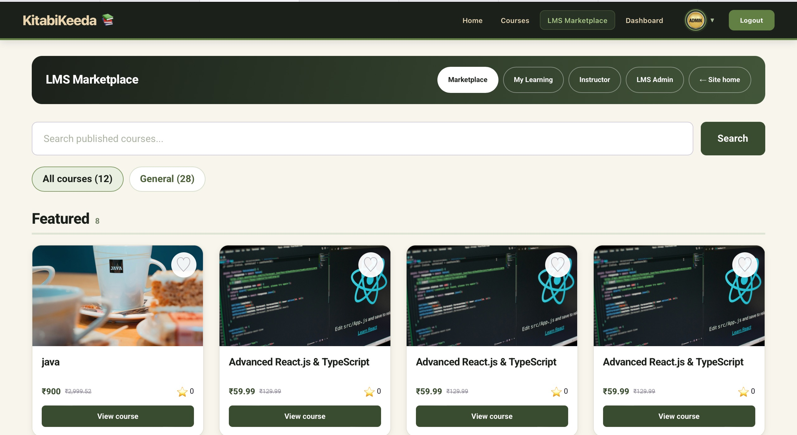

# 📚 KitabiKeeda — Online Learning Management System

**A modern, interactive Learning Management System (LMS) built with React 19.**

KitabiKeeda is an online learning platform designed to make education accessible through course discovery, user authentication, personalized dashboards, and administrative course management.

🌐 **Live Application:** [KitabiKeeda](https://kitabi-keeda-omega.vercel.app)

💻 **GitHub Repository:** [KitabiKeeda on GitHub](https://github.com/Vivek-Prajapathi/KitabiKeeda)

---

## 📸 Screenshots

Here is a preview of the application's user interface and major features.

### 🏠 Home Page


### 📚 Courses Page


### 📖 Course Details


### 🔐 Login Page


### 📝 Registration Page


### 👨‍🎓 User Dashboard


### 👨‍💼 Admin Dashboard


### 🛍️ LMS Marketplace


---

## 📌 Project Overview

KitabiKeeda is a React-based Learning Management System that provides separate experiences for students and administrators.

Users can explore courses, register, log in, manage their profiles, and access their learning dashboard. Administrators can manage users, courses, orders, notifications, coupons, and marketplace content through a dedicated admin dashboard.

The application uses REST APIs for backend communication and Context API for centralized authentication management.

## 🎯 Project Objectives

- Build a responsive and user-friendly online learning platform.
- Implement secure user authentication and authorization.
- Provide role-based access for users and administrators.
- Integrate REST APIs using Axios.
- Develop reusable React components.
- Implement protected routes and centralized state management.
- Create an administrative dashboard for managing LMS operations.

## ✨ Features

### 👨‍🎓 User Features

- User Registration and Login
- Account Activation
- Course Discovery and Exploration
- Course Details
- Personalized User Dashboard
- Profile Management
- Update Profile Information
- Update Password
- Profile Picture Management
- My Learning Section
- Protected User Routes

### 👨‍💼 Admin Features

- Admin Dashboard
- Admin Overview and Analytics
- User Management
- View All Users
- Delete Users
- Update User Roles
- Course Management
- LMS Marketplace Management
- Coupon Management
- Order Management
- Notification Management
- Protected Admin Routes

### 🔐 Authentication and Authorization

- Context API for centralized authentication state.
- Axios instance for API communication.
- Request and response interceptors.
- Bearer token handling.
- Protected routes.
- Role-based authorization.
- Logout functionality.

## 🛠️ Technology Stack

| Category | Technologies |
|---|---|
| Frontend | React 19 |
| Build Tool | Vite |
| Programming Language | JavaScript (ES6+) |
| Markup | HTML5, JSX |
| Styling | CSS3, CSS Modules |
| Routing | React Router DOM |
| State Management | Context API |
| API Integration | Axios |
| Authentication | Token-based Authentication |
| Backend Integration | REST APIs |
| Deployment | Vercel |
| Version Control | Git and GitHub |

## 📂 Project Structure

```text
KitabiKeeda/
│
├── public/
│
├── screenshots/
│   ├── home.jpg
│   ├── courses.jpg
│   ├── course-details.jpg
│   ├── login.jpg
│   ├── Register.jpg
│   ├── dashboard.jpg
│   ├── admin-dashboard.jpg
│   └── marketplace.jpg
│
├── src/
│   ├── admin/
│   │   ├── AdminAnalytics.jsx
│   │   ├── AdminContent.jsx
│   │   ├── AdminDashboard.jsx
│   │   ├── AdminHome.jsx
│   │   ├── AdminLayout.jsx
│   │   ├── AdminNotifications.jsx
│   │   ├── AdminOrders.jsx
│   │   ├── GetAllUsers.jsx
│   │   ├── SingleUser.jsx
│   │   ├── LMSAdminCoupons.jsx
│   │   ├── LMSAdminOverview.jsx
│   │   └── ManageCourses.jsx
│   │
│   ├── api/
│   │   ├── auth.js
│   │   ├── axios.js
│   │   ├── course.js
│   │   ├── lms.js
│   │   └── marketplace.js
│   │
│   ├── assets/
│   │
│   ├── components/
│   │   ├── ApplyLmsCoupon.jsx
│   │   ├── Navbar.jsx
│   │   └── ProtectedRoute.jsx
│   │
│   ├── context/
│   │   └── AuthContext.jsx
│   │
│   ├── hooks/
│   │   └── useAuth.js
│   │
│   ├── pages/
│   │   ├── ActivateAccount.jsx
│   │   ├── CourseDetails.jsx
│   │   ├── Courses.jsx
│   │   ├── Dashboard.jsx
│   │   ├── Home.jsx
│   │   ├── Instructor.jsx
│   │   ├── Login.jsx
│   │   ├── Profile.jsx
│   │   ├── Register.jsx
│   │   └── RegularCourses.jsx
│   │
│   ├── profile/
│   │   ├── MyLearning.jsx
│   │   ├── ProfileContentIndex.jsx
│   │   ├── ProfileDashboard.jsx
│   │   ├── ProfileSettings.jsx
│   │   ├── ProfileSidebar.jsx
│   │   ├── UpdateProfileInfo.jsx
│   │   ├── UpdateProfilePassword.jsx
│   │   └── UpdatedProfilePicture.jsx
│   │
│   ├── App.jsx
│   ├── App.css
│   ├── index.css
│   └── main.jsx
│
├── index.html
├── package.json
├── package-lock.json
├── vite.config.js
├── .gitignore
└── README.md
```

## 🏗️ Application Architecture

The application follows a modular React architecture.

- **Pages:** Main application pages such as Home, Login, Register, Courses, and Dashboard.
- **Components:** Reusable UI components and protected route functionality.
- **Context:** Centralized authentication state using React Context API.
- **Hooks:** Custom hooks for reusable application logic.
- **API:** Separate API modules for authentication, courses, LMS, and marketplace operations.
- **Admin:** Administrative dashboard and management modules.
- **Profile:** User profile, settings, and learning-related components.

## 🔄 Authentication Flow

1. A user registers using the registration form.
2. The account activation process is completed.
3. The user logs in using their credentials.
4. Authentication APIs communicate with the backend through Axios.
5. The authentication token is managed by the application.
6. Context API maintains authentication state.
7. Protected routes restrict access to authorized users.
8. Role-based authorization separates user and admin functionality.
9. Logout clears the authentication state.

## 🌐 API Integration

The application integrates with backend REST APIs using Axios.

**API Base URL:**

```text
https://mockapi-mauve.vercel.app/api/v1
```

API modules are organized separately for maintainability:

- `auth.js` — Authentication-related operations.
- `axios.js` — Shared Axios configuration and interceptors.
- `course.js` — Course-related API operations.
- `lms.js` — LMS-related API operations.
- `marketplace.js` — Marketplace-related API operations.

## 💻 Getting Started

Follow these steps to run the project locally.

### Prerequisites

Make sure you have installed:

- Node.js
- npm
- Git
- Visual Studio Code (recommended)

### 1. Clone the Repository

```bash
git clone https://github.com/Vivek-Prajapathi/KitabiKeeda.git
```

### 2. Navigate to the Project Folder

```bash
cd KitabiKeeda
```

### 3. Install Dependencies

```bash
npm install
```

### 4. Start the Development Server

```bash
npm run dev
```

### 5. Open in Browser

Visit:

```text
http://localhost:5173
```

## 🚀 Build for Production

To create an optimized production build:

```bash
npm run build
```

To preview the production build locally:

```bash
npm run preview
```

## ☁️ Deployment

The application is deployed using Vercel.

**Live Project:** [https://kitabi-keeda-omega.vercel.app](https://kitabi-keeda-omega.vercel.app)

To deploy your own version:

1. Push the project to GitHub.
2. Import the repository into Vercel.
3. Configure the build settings.
4. Deploy the application.

Typical Vite build settings:

- Framework Preset: Vite
- Build Command: `npm run build`
- Output Directory: `dist`

## 📚 Concepts and Skills Demonstrated

This project demonstrates practical implementation of:

- React Functional Components
- JSX and Component Reusability
- React Hooks
- Context API
- Custom Hooks
- React Router DOM
- Nested Routing
- Protected Routes
- Role-Based Access Control
- Axios Instance
- Axios Interceptors
- REST API Integration
- Token-Based Authentication
- JavaScript ES6+
- Responsive UI Development
- CSS Modules
- Git and GitHub
- Vercel Deployment

## 🔮 Future Enhancements

- Online payment gateway integration.
- Course progress tracking.
- Video-based learning modules.
- Student performance analytics.
- Course reviews and ratings.
- Advanced search and filtering.
- Real-time notifications.

## 👨‍💻 Developer

**Vivek Prajapathi**

- GitHub: [Vivek-Prajapathi](https://github.com/Vivek-Prajapathi)
- Project Repository: [KitabiKeeda](https://github.com/Vivek-Prajapathi/KitabiKeeda)
- Live Application: [KitabiKeeda](https://kitabi-keeda-omega.vercel.app)

## 📄 License

This project is developed for educational and portfolio purposes.

---

**KitabiKeeda — Learn, Explore, and Grow. 📚**
